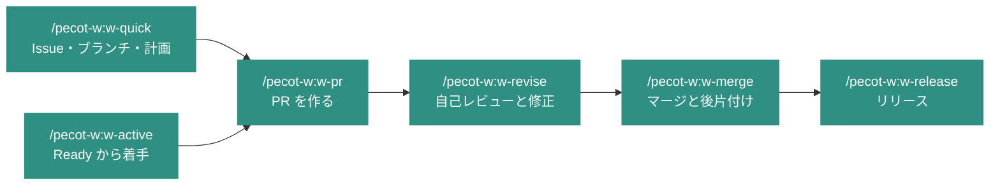

<p align="center">
  <picture>
    <source media="(prefers-color-scheme: dark)" srcset=".github/assets/pecot-wordmark-dark.svg">
    
  </picture>
</p>

<p align="center">
  <b>Claude Code のためのプラグインマーケットプレイス</b><br>
  Issue から PR・リリースまでの開発の流れと、図・スライド作り、AWS の調べものを、スキルで任せる
</p>

<p align="center">
  <a href="#はじめる">はじめる</a> ·
  <a href="#プラグイン">プラグイン</a> ·
  <a href="#開発の流れ">開発の流れ</a> ·
  <a href="#更新">更新</a>
</p>

## はじめる

```bash
claude plugin marketplace add https://github.com/pecotcraft/pecot.git
claude plugin install pecot-w@pecot   # 開発の流れ
claude plugin install pecot-v@pecot   # 図・スライド
claude plugin install pecot-t@pecot   # AWS の調べもの
```

要るものは、入れるプラグインで変わります。

| 要るもの | 入れるプラグイン |
|:--------|:--------------|
| [Claude Code](https://claude.ai/code) 2.1.141 以上 | すべて |
| Node.js 24.22.1 以上（24 系）か 26.12.1 以上 | すべて。これより古い版では起動しない |
| [gh CLI](https://cli.github.com/)。`gh auth refresh -s project` で `project` スコープを足す | pecot-w |
| [AWS CLI](https://aws.amazon.com/cli/) v2（2.22 以上） | pecot-t |

## プラグイン

<table>
  <tr>
    <th width="33%"><a href="plugins/pecot-workflow/README.md">pecot-w</a></th>
    <th width="33%"><a href="plugins/pecot-visual/README.md">pecot-v</a></th>
    <th width="33%"><a href="plugins/pecot-tools/README.md">pecot-t</a></th>
  </tr>
  <tr>
    <td valign="top">GitHub Projects のボードと連動して、Issue の起票から実装・PR・マージ・リリースまでを進める。git worktree での並行作業に対応する</td>
    <td valign="top">draw.io の構成図、Slidev のスライドと PPTX、スクリーンショットをまとめた作業エビデンスの xlsx を作る</td>
    <td valign="top">許可リストで絞った awscli のコマンドを MCP ツールにする。Lambda・CloudWatch Logs・RDS・Athena・S3 などの参照と取得だけで、変更系は拒否する</td>
  </tr>
  <tr>
    <td valign="top"><code>/pecot-w:w-quick</code><br><code>/pecot-w:w-pr</code><br><code>/pecot-w:w-merge</code></td>
    <td valign="top"><code>/pecot-v:v-drawio</code><br><code>/pecot-v:v-slidev</code><br><code>/pecot-v:v-evidence</code></td>
    <td valign="top"><code>aws_logs_filter_log_events</code><br><code>aws_athena_start_query_execution</code><br>ほか 26 ツール</td>
  </tr>
</table>

スキル・エージェント・ツールの一覧は、各プラグインの README にあります。

## 開発の流れ

pecot-w では、ボードの列に沿ってスキルを呼ぶだけで、1 つのタスクが Issue からリリースまで進みます。



小さな修正なら、やりたいことを書いて呼ぶところから始めます。

```text
/pecot-w:w-quick ログイン画面で、エラーの文が英語のまま出るのを直す
```

## 更新

```bash
claude plugin update pecot-w@pecot
claude plugin update pecot-v@pecot
claude plugin update pecot-t@pecot
```

project スコープで入れている場合は `-s project` を付けてください。

## ライセンス

MIT License です。全文は [LICENSE](LICENSE) にあります。
