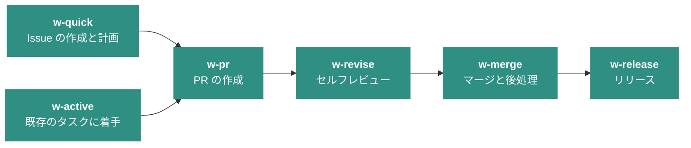

<p align="center">
  <picture>
    <source media="(prefers-color-scheme: dark)" srcset=".github/assets/pecot-wordmark-dark.svg">
    
  </picture>
</p>

<p align="center">
  <b>Claude Code 向けのプラグインマーケットプレイス</b><br>
  Issue の作成からリリースまでの開発作業や、図・スライドの作成、AWS の調査を、Claude Code のスキルで効率化します。
</p>

<p align="center">
  <a href="#はじめに">はじめに</a> ·
  <a href="#プラグイン一覧">プラグイン一覧</a> ·
  <a href="#開発の流れ">開発の流れ</a> ·
  <a href="#アップデート">アップデート</a>
</p>

## はじめに

### 動作環境

pecot のプラグインを使用するには、次のものが必要です。

- [Claude Code](https://claude.ai/code)
- [Node.js](https://nodejs.org/ja)

pecot-w を使用する場合は、[GitHub CLI](https://cli.github.com/) も必要です。認証後に `gh auth refresh -s project` を実行して、`project` スコープを追加してください。

pecot-t を使用する場合は、[AWS CLI](https://aws.amazon.com/cli/) も必要です。

### インストール

マーケットプレイスを追加してから、使用するプラグインをインストールします。

```bash
claude plugin marketplace add https://github.com/pecotcraft/pecot.git
claude plugin install pecot-w@pecot
claude plugin install pecot-v@pecot
claude plugin install pecot-t@pecot
```

## プラグイン一覧

<table>
  <tr>
    <th width="33%"><a href="plugins/pecot-workflow/README.md">pecot-w</a></th>
    <th width="33%"><a href="plugins/pecot-visual/README.md">pecot-v</a></th>
    <th width="33%"><a href="plugins/pecot-tools/README.md">pecot-t</a></th>
  </tr>
  <tr>
    <td valign="top">GitHub Projects と連携して、Issue の作成から実装、PR、マージ、リリースまでの開発フローを自動化します。git worktree を使用した並行開発にも対応しています。</td>
    <td valign="top">draw.io の構成図、Slidev のプレゼンテーション、スクリーンショットをまとめた作業エビデンスを作成します。プレゼンテーションは PPTX に、エビデンスは xlsx に出力できます。</td>
    <td valign="top">許可リストで限定した AWS CLI のコマンドを、MCP ツールとして提供します。Lambda や CloudWatch Logs、RDS などの参照、Athena のクエリ、S3 からのダウンロードに使用できます。リソースを変更する操作は実行できません。</td>
  </tr>
  <tr>
    <td valign="top">主なスキル<br><code>/pecot-w:w-quick</code><br><code>/pecot-w:w-pr</code><br><code>/pecot-w:w-merge</code></td>
    <td valign="top">主なスキル<br><code>/pecot-v:v-drawio</code><br><code>/pecot-v:v-slidev</code><br><code>/pecot-v:v-evidence</code></td>
    <td valign="top">主なツール（全 26 種）<br><code>aws_logs_filter_log_events</code><br><code>aws_athena_start_query_execution</code><br><code>aws_s3_cp</code></td>
  </tr>
</table>

各プラグインのスキル、エージェント、ツールの一覧は、それぞれの README を参照してください。

## 開発の流れ

pecot-w のスキルを順に実行すると、1 つのタスクを Issue の作成からリリースまで進められます。
図中のスキルは、`/pecot-w:w-quick` のように、名前の前に `/pecot-w:` を付けて実行します。



たとえば小さな修正であれば、修正したい内容を添えて `w-quick` を実行します。

```text
/pecot-w:w-quick ログイン画面のエラーメッセージが英語のまま表示される問題を修正する
```

## アップデート

最新のバージョンに更新するには、次のコマンドを実行します。

```bash
claude plugin update pecot-w@pecot
claude plugin update pecot-v@pecot
claude plugin update pecot-t@pecot
```

プロジェクトスコープでインストールした場合は、`-s project` を付けて実行してください。

## ライセンス

MIT License で公開しています。詳しくは [LICENSE](LICENSE) を参照してください。
