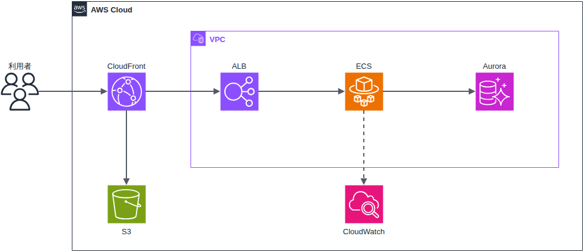

<p align="center">
  <picture>
    <source media="(prefers-color-scheme: dark)" srcset=".github/assets/pecot-badge-dark.svg">
    
  </picture>
</p>

<p align="center">
  <b>GitHub での開発の手順と、構成図やスライドの作成を、Claude Code のスキルで進めるプラグイン集です。</b>
</p>

## Issue からリリースまでを自動化する

pecot-w は、GitHub Projects のボードと連携して開発の流れを進める Claude Code のプラグインです。

**Issue や PR の本文を書く必要はありません。**
作業の内容から、Claude Code が Issue、実装計画、PR の説明文を作成します。

**ボードは自動で更新されます。**
着手すると Active へ、PR を作成すると In Review へ、マージすると Archived へ、タスクが移動します。
pecot の開発もこの仕組みで進めています。実際のボードは [pecot-project](https://github.com/orgs/pecotcraft/projects/1) で公開しています。

**複数のタスクを並行して進められます。**
git worktree を使用して、タスクごとに作業ディレクトリを分けられます。

たとえば次のように実行すると、Issue とブランチを作成し、実装計画を立てるところまでを Claude Code が行います。

```text
/pecot-w:w-quick ログイン画面のエラーメッセージが英語のまま表示される問題を修正する
```

主なスキルは次のとおりです。

| スキル | 用途 |
|:------|:----|
| `/pecot-w:w-quick` | 小さな修正の Issue、ブランチ、実装計画を作成する |
| `/pecot-w:w-active` | ボードの Ready から次のタスクを選んで着手する |
| `/pecot-w:w-pr` | PR を作成する |
| `/pecot-w:w-revise` | PR をセルフレビューして修正する |
| `/pecot-w:w-merge` | PR をマージして後処理をする |
| `/pecot-w:w-release` | リリースする |

すべてのスキルは [pecot-w の README](plugins/pecot-workflow/README.md) を参照してください。

## 構成図やスライドを作成する

pecot-v を使用すると、Claude Code との会話から draw.io の構成図や Slidev のプレゼンテーションを作成できます。
プレゼンテーションは PPTX に変換できます。また、スクリーンショットをまとめて、作業エビデンスの xlsx を作成できます。

<p align="center">
  
</p>

```text
/pecot-v:v-drawio CloudFront、ALB、ECS、Aurora で構成した Web アプリの構成図を描く
```

詳しくは [pecot-v の README](plugins/pecot-visual/README.md) を参照してください。

## インストール

### 動作環境

pecot のプラグインを使用するには、次のものが必要です。

- [Claude Code](https://claude.ai/code)
- [Node.js](https://nodejs.org/ja)

pecot-w を使用する場合は、[GitHub CLI](https://cli.github.com/) も必要です。認証後に `gh auth refresh -s project` を実行して、`project` スコープを追加してください。

### インストール手順

マーケットプレイスを追加してから、使用するプラグインをインストールします。

```bash
claude plugin marketplace add https://github.com/pecotcraft/pecot.git
claude plugin install pecot-w@pecot
claude plugin install pecot-v@pecot
```

### アップデート

最新のバージョンに更新するには、次のコマンドを実行します。

```bash
claude plugin update pecot-w@pecot
claude plugin update pecot-v@pecot
```

プロジェクトスコープでインストールした場合は、`-s project` を付けて実行してください。

## ライセンス

MIT License で公開しています。詳しくは [LICENSE](LICENSE) を参照してください。
