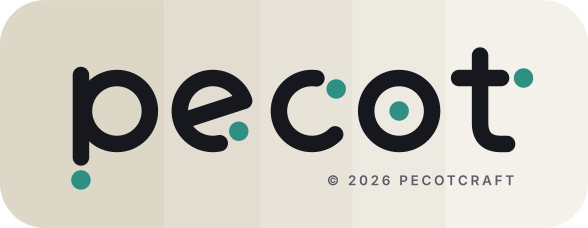

<p align="center">
  <picture>
    <source media="(prefers-color-scheme: dark)" srcset=".github/assets/pecot-badge-dark.svg">
    
  </picture>
</p>

<h3 align="center">Claude Code を、手を抜かない開発チームに。</h3>

<p align="center">
  計画を立て、レビューを受け、動作を確かめてから PR を出す。<br>
  チーム開発の手順を、Claude Code のスキルとして提供します。
</p>

<p align="center">
  
  
  
</p>

`/pecot-w:w-active` でボードのタスクに着手すると、Claude Code はまずコードを読み、実装計画を書きます。
計画はレビュー用のエージェントが確認したうえで Issue に投稿され、あなたが承認するまで実装は始まりません。

小さな修正なら、内容を添えて `/pecot-w:w-quick` を実行するだけで、Issue とブランチの作成から計画までを進められます。

```text
/pecot-w:w-quick ログイン画面のエラーメッセージが英語のまま表示される問題を修正する
```

`/pecot-w:w-pr` で作成する PR には、変更点に加えて、利用者の操作で動作を確かめた手順と結果、画面のスクリーンショットが載ります。
どれかが欠けていると、PR は作成されません。

PR の作成後は CI の結果を待ち、PR が原因で失敗したものは Claude Code が修正します。

`/pecot-w:w-revise` を実行すると、計画を確認したのと同じレビュー用のエージェントが、PR の差分を確認します。
観点は、標準への適合と技術的な正確さ、動作確認とテストの質、コードの質の 3 つです。
指摘は番号付きで PR にコメントされ、採用した指摘を Claude Code が修正します。

GitHub Projects のボードの列は、着手・PR の作成・マージに合わせて自動で移ります。
前提となる Issue が片づくと、それを待っていたタスクは Blocked から Ready に移ります。

大きな機能は Epic として登録し、`/pecot-w:w-breakdown` で speckit を使って分解すると、前提の関係を持ったタスクとして一括で起票できます。

pecot 自身も、この仕組みで開発しています。実際のボードは [pecot-project](https://github.com/orgs/pecotcraft/projects/1) で公開しています。

すべてのスキルは [pecot-w の README](plugins/pecot-workflow/README.md) を参照してください。

pecot-v を使用すると、Claude Code との会話から draw.io の構成図や Slidev のプレゼンテーションを作成できます。

作成した図やスライドは、そのたびに自動でチェックされます。
図ではラベルの折り返しとフォントの指定を、スライドでは PPTX に変換したときの崩れや文字のはみ出しを確認し、問題があれば Claude Code が直します。

<p align="center">
  
</p>

```text
/pecot-v:v-drawio CloudFront、ALB、ECS、Aurora で構成した Web アプリの構成図を描く
```

また、スクリーンショットをまとめて、作業エビデンスの xlsx を作成できます。
詳しくは [pecot-v の README](plugins/pecot-visual/README.md) を参照してください。

## インストール

### 動作環境

| ソフトウェア | 必要なプラグイン | 用途 |
|:-----------|:--------------|:----|
| [Claude Code](https://claude.ai/code) | pecot-w、pecot-v | プラグインを読み込んで実行します |
| [Node.js](https://nodejs.org/ja) | pecot-w、pecot-v | プラグインの実行に使用します。初回の実行時に、必要なパッケージを自動で取得します |
| [Git](https://git-scm.com/) | pecot-w | ブランチと worktree の操作に使用します |
| [GitHub CLI](https://cli.github.com/) | pecot-w | Issue、PR、GitHub Projects のボードの操作に使用します |

GitHub CLI は、`gh auth login` で認証したあと、`gh auth refresh -s project` を実行して `project` スコープを追加してください。
ボードの操作にはこのスコープが必要です。

### インストール手順

マーケットプレイスを追加してから、使用するプラグインをインストールします。

```bash
claude plugin marketplace add https://github.com/pecotcraft/pecot.git
claude plugin install pecot-w@pecot
claude plugin install pecot-v@pecot
```

pecot-w を初めて使用するときは、作業するリポジトリで `/pecot-w:w-onboarding` を実行して、GitHub Projects のボードを作成してください。

### アップデート

最新のバージョンに更新するには、次のコマンドを実行します。

```bash
claude plugin update pecot-w@pecot
claude plugin update pecot-v@pecot
```

プロジェクトスコープでインストールした場合は、`-s project` を付けて実行してください。

MIT License で公開しています。詳しくは [LICENSE](LICENSE) を参照してください。
